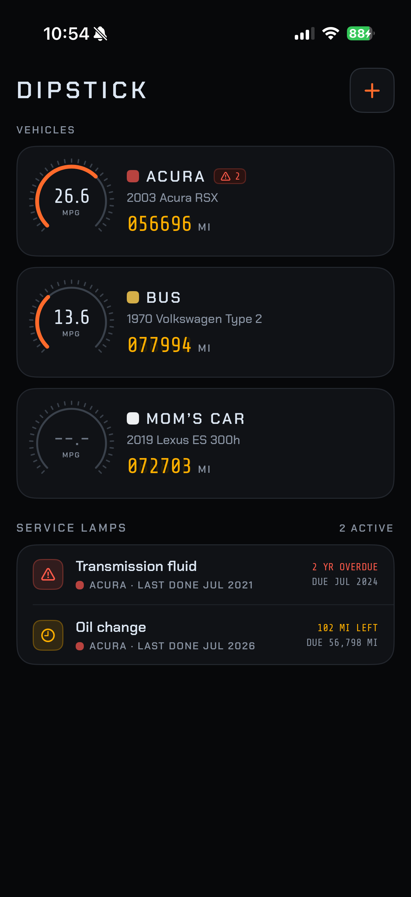
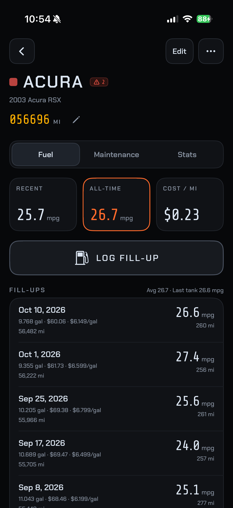
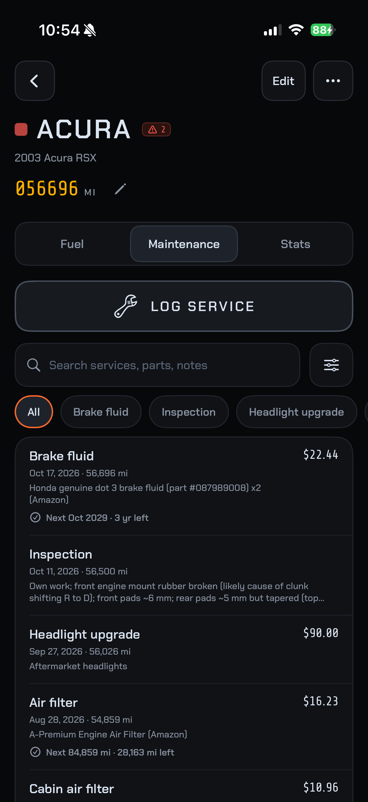
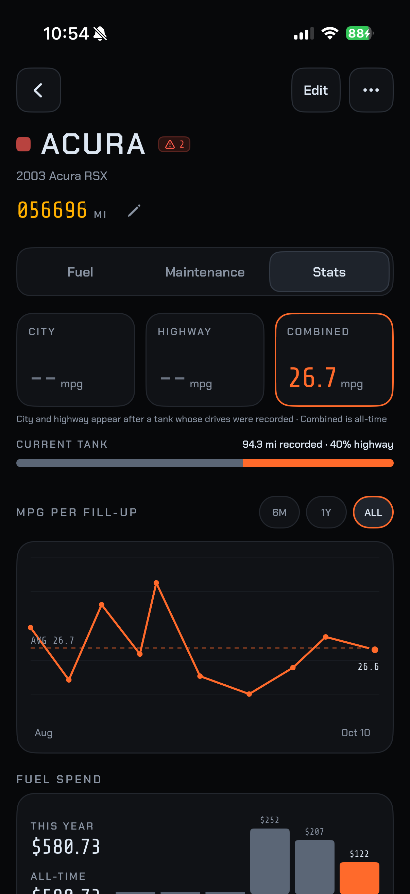

# Dipstick

A personal iPhone app for tracking fuel fill-ups and maintenance on my cars, with automatic MPG calculation and city/highway driving detection.

> **Status: in development.** I use it day to day on my own cars. Some features are still being road-tested (marked below).

<p>
  
  
  
  
</p>

## Why

My maintenance records were spread across paper notebooks and iPhone Notes, and I was calculating MPG by hand after every fill-up. Dipstick puts it all in one place, does the math automatically, and tells me when service is due.

## Features

**Working**
- **Multiple vehicles** with year/make/model, VIN and odometer
- **Fuel log** with automatic MPG between full tanks (partial fills roll into the next full tank), miles per tank, last-tank and average MPG
- **Maintenance log** with parts (part numbers, quantities, costs), labor/shop totals, search and filtering by service type
- **Service reminders**: "next due" by miles and/or time, with a due-soon and overdue list across all cars on the home screen
- **Stats**: MPG trend chart, monthly fuel spend, cost per mile
- **CSV import/export** for bringing in existing records and backing up

**In testing**
- **Automatic trip recording**: drives start and stop on their own when the phone connects to the car (CarPlay or Bluetooth, via Shortcuts automations), and each car is recognized by its connection
- **City/highway split**: GPS speed is used to classify each half-mile of a drive as city or highway. Only mile totals are saved, never the route
- **City, highway and combined MPG**: once a tank's drives are recorded, city and highway MPG are solved across all tracked tanks from each tank's mix and gallons. The estimate gets more accurate as tanks with different mixes add up
- **Pump scanning**: point the camera at the pump's screen to fill in gallons and total. Text is read on-device and no photo is saved

**Planned**
- iCloud sync
- Importing maintenance schedules from owner's manuals

## Tech

- **Swift / SwiftUI**, iOS 17+
- **SwiftData** for on-device storage (models kept CloudKit-compatible for future iCloud sync)
- **Swift Charts** for the MPG and spend charts
- **Core Location** (live updates with background sessions) for trip recording
- **App Intents** for the Start/Stop Trip Shortcuts actions
- **VisionKit** live text recognition for pump scanning
- **Swift Testing** unit tests for the core logic (MPG, due dates, stats, CSV, trip classification, pump-screen parsing)

No backend: all data stays on the phone.

## Project layout

```
Dipstick/
  Models/        SwiftData models (Vehicle, FuelEntry, MaintenanceEntry, PartUsed, Trip)
  Logic/         Plain Swift logic with unit tests (MPG, due dates, stats, CSV, trips, pump parsing)
  Views/         SwiftUI screens (Vehicles, Fuel, Maintenance, Stats)
DipstickTests/   Unit tests
docs/            Design notes and the CSV format
tools/           Helper scripts for tuning trip classification and testing pump photos
```

## Building

Open `Dipstick.xcodeproj` in Xcode and run on an iPhone or the simulator. Trip recording and pump scanning need a real device.
